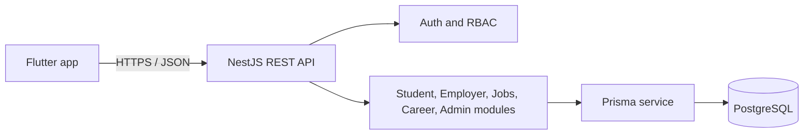

# Commit 02 — Backend architecture and API requirements

## Architecture decision

The repository currently contains only the Flutter client. Add a separate `backend/` workspace using NestJS, TypeScript, PostgreSQL, and Prisma. Keep the Flutter application at the repository root. The server should be a modular monolith for the academic project: one deployable API, explicit domain modules, and database transactions at service boundaries where multiple records change together.

### Server layering

- Controllers own HTTP routes, DTO validation, and status codes.
- Services own business rules and authorization-sensitive operations.
- Prisma is accessed through a single injectable Prisma module/service, not directly from controllers.
- DTOs define input/output contracts; Prisma models are not returned directly to clients.
- A global validation pipe rejects unknown or invalid input. A consistent exception/response policy and request logging must avoid secrets and personal document contents.
- REST routes use a version prefix (`/api/v1`) and Swagger is generated from the same DTO/controller definitions.
- Authentication uses short-lived JWT access tokens and rotating refresh tokens. Passwords are hashed with bcrypt. Roles are `STUDENT`, `EMPLOYER`, and `ADMIN`; resource ownership is checked in services in addition to role guards.

## Domain boundaries and first API contract inventory

| Domain/module | Client capability represented today | Initial API responsibilities | Access boundary |
|---|---|---|---|
| Auth | Signup/login/reset UI | Register, login, refresh, logout, current user, password reset token lifecycle | Public for registration/login/reset request; authenticated for session/user; role assigned server-side |
| Students | Student profile, education, skills, interests, CV metadata | Read/update own profile; add/remove skills/interests; list/create/update resume metadata | Student owns profile and resumes; never accept caller-selected account role |
| Employers and companies | Employer signup, company profile and verification screens | Employer profile; company create/read/update; verification request and status | Employer manages own company; only Admin changes verification decision |
| Jobs | Search, filters, detail, saved, recommendations | Public/authorized search according to policy; job detail; employer CRUD; saved-job add/remove/list | Only owning employer edits; saved jobs belong to current student |
| Applications | Apply, CV selection, review, tracking, employer candidates | Student submit/list/detail/withdraw; employer candidate list/detail/status transition/history | Student owns submission; employer sees applications to owned jobs; validate allowed status transitions |
| Career guidance | Goals, assessment, skill gap, roadmap, resources, interview demo | Persist assessment answers/results and goals; deterministic match/skill-gap and roadmap endpoints | Student-only private records; explain rule-based calculations; no claim of trained AI |
| Notifications | Student/employer/admin notification UI | List, unread count, mark read | Current user can access only own notifications |
| Admin and moderation | Admin user/company/job/report screens | User management, company/job review, reports, audit records | Admin role enforced server-side for every operation |
| Dashboard | Student/employer/admin summary cards | Aggregates computed from persisted records | Role-scoped aggregate data; no hard-coded demo counters |

Endpoint names and payloads remain provisional until DTOs and screens are implemented together. Prefer resource-oriented routes and pagination for collections. Every list response should have stable ordering and bounded page size. Search/filter parameters must be validated and mapped to database queries rather than interpolated SQL.

## Initial relational model outline

The schema should be normalized around `User`, `StudentProfile`, `EmployerProfile`, and `Company`. Domain tables are expected for skills and join records, interests, resumes, jobs and job skills, saved jobs, applications and application status history, career assessments/answers/results, goals/milestones/tasks, notifications, reports, and admin audit events. All user-owned records carry foreign keys to their owner. Use unique constraints for normalized email, saved `(studentId, jobId)`, and application `(studentId, jobId)` where duplicate applications are disallowed. Add indexes for job status/location/category, application ownership/status/date, and notification ownership/read status after query needs are confirmed.

Use UUID identifiers unless an existing interoperability need is found. Store timestamps in UTC. Money uses integer minor units or a fixed-precision decimal with an explicit currency. Avoid storing raw passwords, refresh tokens, reset tokens, or uploaded file bytes in ordinary columns; store password hashes and hashes of refresh/reset tokens. Resume metadata and actual file storage need a separate explicit decision before upload support is claimed.

## Data migration from the current client

Current Riverpod demo state is not an importable database. No production user records are present in the app. Seed data should be deterministic, synthetic, idempotent, and clearly identified as development data. Existing client-side demo content should remain available until a corresponding endpoint is integrated and tested. The server must not treat Figma sample identities, match scores, verification marks, or application statuses as real users or events.

## Cross-cutting requirements

- Password hashing, JWT signing keys, database URLs, and mail credentials come only from validated environment configuration; commit `.env.example`, never `.env` or real secrets.
- Configure CORS for explicit development origins. Do not disable network security in production.
- Rate-limit authentication and other abuse-prone public endpoints; apply security headers and redact authorization/cookie/password/token fields from logs.
- Email reset delivery remains disabled until a real provider is configured. Development may expose a reset token only through a test adapter, not falsely report email delivery.
- Uploaded files require type/size validation, ownership checks, private storage, and a documented retention policy before exposing an upload endpoint.
- API errors should be actionable without exposing SQL, stack traces, credentials, or internal identifiers unnecessarily.
- Matching in the first implementation is transparent rule-based scoring with versioned weights and explanations, not a trained AI model.

## Delivery boundaries

1. Establish the backend workspace, environment validation, database connection, Prisma schema, migrations, seed, and health endpoint.
2. Implement authentication and authorization before protected domain endpoints.
3. Add student/employer/job/application/career/admin domains in dependency order with unit and API tests.
4. Integrate Flutter through an API/repository boundary, keeping demo providers as a fallback until each remote flow is verified.
5. Do not change the existing six modified Flutter files without reviewing and obtaining the owner’s permission, as explicitly requested.

This document defines requirements; it does not claim that any endpoint, database, authentication mechanism, or AI service exists yet.
